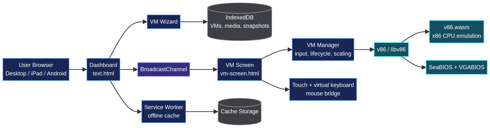

<div align="center">

  <video src="https://github.com/user-attachments/assets/338656cf-cc76-4a87-a494-750f81ccee6b" controls playsinline preload="metadata" width="100%">Your browser does not support the video element.</video>

  <h1>Web VM Emulator</h1>
  <p><strong>Your own x86 virtual machine. Right inside your browser.</strong></p>
  <p>Boot operating systems, create virtual disks, and use a touch-friendly VM workspace — no traditional hypervisor installation required.</p>

  <p>
    <a href="https://virtual-machine.pages.dev/"><strong>🚀 Launch Live Demo</strong></a>
    &nbsp;·&nbsp;
    <a href="#getting-started">Get Started</a>
    &nbsp;·&nbsp;
    <a href="#features">Features</a>
  </p>

  <p>
    
    
    
    <a href="LICENSE"></a>
  </p>

</div>

---

## What is Web VM Emulator?

**Web VM Emulator** is a browser-based x86 virtual machine environment powered by [v86](https://github.com/copy/v86) and WebAssembly.

It brings the essentials of a desktop VM manager to the web. Create a machine, load an ISO or IMG image, configure memory and storage, then boot your guest operating system — directly in a modern browser.

The experience is designed for desktop and mobile devices, including iPad and Android tablets. Your machine configurations and virtual storage stay in your browser using IndexedDB.

## Features

| | Feature | Description |
|---|---|---|
| ⚡ | **x86 emulation** | Run compatible x86 operating systems with v86 + WebAssembly. |
| 💿 | **Bootable media** | Load ISO and IMG files to boot a guest system. |
| 💾 | **Virtual disks** | Create browser-backed storage for your virtual machines. |
| 📱 | **Touch controls** | Use touch-to-mouse input and an on-screen keyboard. |
| 🧩 | **VM snapshots** | Save and import machine states for later sessions. |
| 💽 | **Local persistence** | Keep machine settings, media, disks, and snapshots in IndexedDB. |
| 🌐 | **Offline support** | Cache the application shell and core emulator assets. |
| 🖥️ | **Dedicated VM screen** | Run the guest display in its own screen view. |
| 🎛️ | **Machine controls** | Start, pause, reset, stop, fullscreen, and send Ctrl+Alt+Del. |
| 📐 | **Responsive UI** | Adapt the workspace to desktop, tablet, and mobile screens. |

## Getting started

### Use it online

1. Open the **[Live Demo](https://virtual-machine.pages.dev/)**.
2. Allow pop-ups for the site. Each VM opens in a separate screen view.
3. Select **Create New Machine**.
4. Choose an ISO or IMG boot image and upload it.
5. Configure memory, boot order, and optional virtual storage.
6. Create your machine and press **Start**.

> **Tip:** Start with a lightweight, bootable guest image for the smoothest experience, especially on mobile devices.

### Run locally

You'll need Git and Python 3 (or another static HTTP server).

```bash
git clone https://github.com/Quincunx33/Virtual-machine.git
cd Virtual-machine
python3 -m http.server 8080
```

Open **http://localhost:8080/text.html** in your browser.

A local HTTP server is recommended instead of opening the HTML file directly, because browser features such as WebAssembly loading and service workers work more reliably over HTTP or HTTPS.

If you're using the included Vite workflow, install the project dependencies and run:

```bash
npm install
npm run dev
```

## Built with

| Technology | Role |
|---|---|
| **JavaScript** | Application logic and user interface |
| **v86** | x86 system emulation |
| **WebAssembly** | Runs the emulator engine in the browser |
| **IndexedDB** | Local machine, media, disk, and snapshot storage |
| **Service Worker** | Application asset caching and offline support |
| **Browser APIs** | Keyboard, pointer, touch, fullscreen, and cross-window communication |

## How it works

The application is organized around a dashboard and a dedicated VM screen:

- **Dashboard** — create machines, manage uploaded media, configure storage, and manage snapshots.
- **VM screen** — initialize the emulator, render the guest display, and handle keyboard, pointer, and touch input.
- **IndexedDB** — persist machine data locally in the browser.
- **BroadcastChannel** — coordinate communication between the dashboard and VM screen.
- **Service Worker** — cache application resources for supported offline use.

<p align="center">
  
</p>

## Mobile experience

Web VM Emulator is built to be usable beyond a traditional desktop setup.

- Open it in Safari on iPad or Chrome on Android.
- Use the virtual keyboard for guest OS input.
- Tap the guest display to interact with the virtual pointer.
- Try landscape orientation for operating systems with wide displays.

For the best results, use a modern browser, keep browser zoom at 100%, and choose a guest OS that fits your device's available memory.

## Storage & privacy

Machine configurations, uploaded boot media, virtual disks, and snapshots are stored locally in your browser's **IndexedDB** for this website's origin.

The service worker uses Cache Storage for application resources. Clearing browser site data, using private browsing, or browser storage cleanup may remove locally stored VM data. Export important snapshots before clearing site data or changing browsers.

## Troubleshooting

<details>
<summary><strong>Start button opens no VM window</strong></summary>

Allow pop-ups for the live demo, then try starting the machine again.
</details>

<details>
<summary><strong>The guest OS does not boot</strong></summary>

Check that your ISO or IMG is bootable, verify the boot order, and try a lightweight guest image. Not every operating system or image format is compatible with browser-based x86 emulation.
</details>

<details>
<summary><strong>Touch or pointer input feels inaccurate</strong></summary>

Set browser zoom to 100%, make sure the VM display is fully visible, and reload the latest application version.
</details>

<details>
<summary><strong>Offline mode is not working</strong></summary>

Enable Offline Caching in the dashboard and reload the application. Service workers require a secure context, such as HTTPS or localhost.
</details>

## Contributing

Found a bug or have an idea? Contributions are welcome.

1. Fork the repository.
2. Create a focused branch for your change.
3. Test the change in a desktop browser and, where relevant, a touch device.
4. Open a pull request with a clear description and testing notes.

Please don't commit copyrighted guest OS images, private VM snapshots, or other large user media files.

## License & credits

Released under the **MIT License**. See [LICENSE](LICENSE).

The emulation engine is powered by the open-source [v86 project](https://github.com/copy/v86). Web VM Emulator also uses standard browser technologies such as WebAssembly, IndexedDB, and Service Workers.

---

<div align="center">

  **A virtual machine, one browser tab away.**

  <a href="https://virtual-machine.pages.dev/">Try Web VM Emulator</a>
  <br>
  <sub>Built for the open web · Made by <a href="https://github.com/Quincunx33">Quincunx33</a></sub>

</div>
